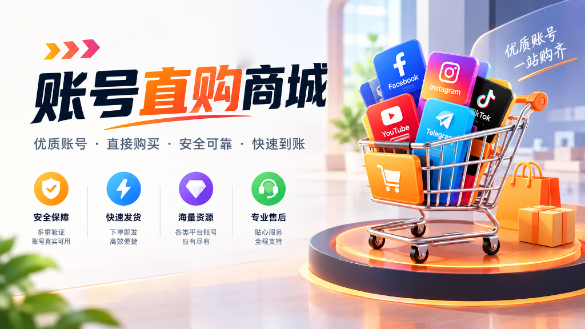

# LINE账号经销找回操作攻略

LINE账号经销找回操作攻略：LINE账号经销找回的关键是确认账号归属，并通过LINE官方申诉渠道处理，不能依赖所谓“内部解封”或绕过验证。先准备注册手机号、绑定邮箱、常用设备、最后登录时间及交易凭证，再按页面提示提交资料，通常比反复输入错误密码更有效。

[➡️➡️➡️ 社媒账号自助下单](https://9527shop.com)

什么是LINE账号经销找回

LINE账号经销找回，通常指经销商或长期管理多个账号时，因忘记密码、手机号停用、设备更换、异常登录或账号被限制而进行的恢复操作。它本质上是账号验证与安全申诉，不代表可以转移他人账号，也不等同于购买新账号。只有原注册人或获得授权的管理者，才应提交找回申请。

LINE账号经销找回有什么作用或优势

规范处理能够尽量保留联系人、聊天记录、群组及业务资料，减少重新注册造成的客户流失。对于批量运营场景，建立账号清单、绑定可长期使用的邮箱，并记录设备和登录地区，可明显提高后续申诉效率。实际案例中，某经销团队因更换手机无法登录，补充旧设备截图和实名资料后，成功恢复了账号使用权。

如何进行LINE账号经销找回

确认是否仍能接收绑定手机号或邮箱的验证码。
使用常用设备和稳定网络，优先尝试官方密码重置。
无法验证时，进入LINE帮助中心提交申诉，准确填写注册信息、账号用途和异常时间。
提交后避免重复创建工单，也不要向陌生人提供验证码、密码或身份证件。

常见问题

手机号注销还能找回吗？可尝试使用绑定邮箱或官方申诉，但是否恢复取决于资料完整度。

找回需要多久？审核时间因案件而异，应以官方邮件或页面通知为准。

经销商能找回客户账号吗？必须获得账号所有者明确授权，否则可能引发隐私和账号归属争议。

有人承诺百分百找回可信吗？不可信。LINE账号经销找回应只通过官方渠道完成，谨防付费诈骗。